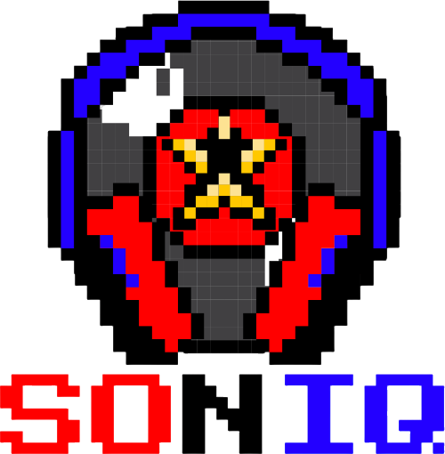
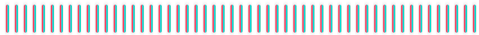

<div align="center">
  

  <br />

  <a href="https://git.io/typing-svg">
    
  </a>

  <br />

  

  <br />

  [](https://en.cppreference.com/w/cpp/20)
  [](https://www.qt.io/)
  []()
  []()
  [](LICENSE)
</div>

---

SONIQ is a modern, offline-first, cross-platform audiophile desktop music player for Windows, Linux, and macOS. Built with modern **C++20**, **Qt 6**, **Qt Quick/QML**, and native platform audio drivers (**WASAPI Exclusive Mode** on Windows), SONIQ delivers bit-perfect audio reproduction, studio-grade 64-bit DSP filtering, high-performance local library indexing, and a clean, responsive desktop user experience.

---

## Key Highlights

- **Pure Audiophile Audio Path**: Bit-perfect playback verification with zero unneeded software volume scaling, resampling, or dithering in exclusive output mode.
- **Dedicated Audio Threading**: Audio engine, decoding, and signal pipeline run decoupled from the UI thread, ensuring zero stuttering during UI animations, scanning, or window resizing.
- **Native DSD & DoP Engine**: Native Direct Stream Digital bitstream handling for `.dsf` and `.dff` files via DoP v1.1 (DSD over PCM at 176.4/352.8 kHz) for bit-perfect hardware playback and 64-tap linear-phase FIR decimation (40 kHz cutoff) for software rendering.
- **Gapless Transitions & Lookahead Buffering**: Seamless zero-gap track transitions with background lookahead pre-buffering, zero-restart endpoint reuse, and optional equal-power constant-acoustic-power crossfading.
- **Universal Audio Decoding**: Direct low-latency PCM RIFF/WAV decoding, DSD/DSF/DFF engine, and universal FFmpeg audio streaming (FLAC, ALAC, WAV, AIFF, MP3, AAC, OGG Vorbis, Opus, WavPack, APE, and more).
- **Format-Aware Artwork Extraction**: High-speed extraction of embedded album artwork from FLAC picture blocks, MP3 ID3v2 APIC tags, and stream copy to persistent disk cache.
- **Studio DSP Engine**:
  - 10-Band Graphic EQ (ISO Standard Octave bands)
  - 31-Band Graphic EQ (1/3 Octave bands)
  - Parametric EQ (Peaking, Low Shelf, High Shelf, High Pass, Low Pass, Notch)
  - Master Preamp Gain (-24 dB to +24 dB)
  - Bauer Stereophonic-to-Binaural Crossfeed (headphone acoustic fatigue reduction)
  - Lookahead Peak Limiter & Transparent Anti-Clipping
  - Bit-Perfect Integrity Audit (identifies and explains any active DSP modifying raw samples)
- **Offline-First & Privacy Conscious**:
  - Zero mandatory accounts or online telemetry
  - Local SQLite database with versioned schema migrations (v1 and v2)
  - Asynchronous recursive library scanner
  - Full playlist management and instant search
- **Design System & Presentation**:
  - Unified design tokens for dark and light themes
  - Persistent mini-player with scrubbing timeline, album artwork, and real-time spectrum visualizer
  - Centerpiece Now Playing screen and slide-in Playing Queue drawer
  - Technical Audio File Inspector showing container, codec, sample rate, bit depth, channel configuration, and bit-perfect eligibility audit

---

## Technology Stack

<p align="center">
  
  &nbsp;
  
  &nbsp;
  
  &nbsp;
  
  &nbsp;
  
  &nbsp;
  
  &nbsp;
  
  &nbsp;
  
</p>

<br />

| Layer | Technology | Details |
| :--- | :--- | :--- |
| **Language** |  **C++20** | Modern ISO C++20 standard (`std::span`, `std::format`, `std::atomic`, RAII, smart pointers) |
| **UI Framework** |  **Qt 6.8+ Quick / QML** | Declarative QML UI, Hardware-Accelerated SceneGraph, reactive signal-slot bindings |
| **Audio Engine** |  **Windows Core Audio (WASAPI)** | Event-driven Exclusive Mode (bit-perfect direct hardware) & Shared Mode with autoconvert fallback |
| **Audio Decoding** |  **FFmpeg & Direct WAV Parser** | Universal 32-bit float streaming pipeline (FLAC, ALAC, DSD/DoP, MP3, AAC, OGG) + direct RIFF header reader |
| **Database** |  **SQLite 3 (Qt6Sql)** | High-concurrency WAL mode journal, prepared statements, automated schema migrations (v1/v2) |
| **Build System** |  **CMake & Ninja** | Fast parallel build generation, automated MOC/RCC compilation, modular architecture |
| **Compiler Toolchain** |  **LLVM / Clang (MinGW-w64)** | High-performance C++20 compiler with LLD linker and full UCRT runtime integration |
| **Testing Suite** |  **CTest & Automated Suite** | Unit and integration test suite covering DSP filters, DSD DoP packing, database, and gapless audio |

---

## Directory Structure

```
SONIQ/
├── CMakeLists.txt          # Root CMake build definition
├── resources.qrc           # Qt QML resource collection
├── app/
│   └── main.cpp            # Main application bootstrap and service wiring
├── src/
│   ├── core/               # Types, AudioFormat, Logger, Result, Error
│   ├── audio/              # PlaybackEngine, Decoders, Buffer, Queue
│   │   └── output/         # IAudioOutput, WASAPIAudioOutput, NullAudioOutput
│   ├── dsp/                # BiquadFilter, Equalizer, Limiter, Crossfeed, DspPipeline
│   ├── database/           # SQLite DatabaseManager and Schema Migrations
│   ├── library/            # LibraryScanner and Track models
│   ├── metadata/           # AudioProbe (container & codec inspection)
│   └── services/           # PlaybackController, LibraryModel, DspService, SettingsService
├── ui/
│   ├── main.qml            # Application root window and layout shell
│   ├── themes/             # Design tokens: Colors, Typography, Motion, Theme
│   ├── components/         # Reusable SoniqButton, SoniqSlider, SoniqTrackRow, SoniqSpectrum
│   ├── panels/             # NavigationSidebar, MiniPlayer, QueueDrawer
│   └── screens/            # HomeScreen, SongsScreen, NowPlayingScreen, EqualizerScreen, SettingsScreen
├── tests/
│   └── unit/               # Automated unit tests for DSP, Audio Engine, Database, Queue
└── docs/                   # Architectural and operational documentation
```

---

## Quick Start: Building & Running

### Prerequisites
- CMake 3.22 or higher
- C++20 compliant compiler (Clang 16+, GCC 13+, or MSVC 2022)
- Qt 6.5+ (Qt Core, Gui, Qml, Quick, QuickControls2, Sql)
- Ninja build tool

### Commands (Windows PowerShell)

```powershell
# 1. Configure the build with Ninja and your Qt 6 installation
cmake -B build -G Ninja -DCMAKE_PREFIX_PATH="D:/Qt/6.8.2/llvm-mingw_64" -DCMAKE_CXX_COMPILER=clang++

# 2. Build the core library, desktop application, and test suite
cmake --build build

# 3. Run the automated test suite via CTest
$env:PATH = "C:\Users\Rohan JM\AppData\Local\Microsoft\WinGet\Packages\MartinStorsjo.LLVM-MinGW.UCRT_Microsoft.Winget.Source_8wekyb3d8bbwe\llvm-mingw-20260616-ucrt-x86_64\bin;D:\Qt\6.8.2\llvm-mingw_64\bin;$env:PATH"
ctest --test-dir build --output-on-failure

# 4. Launch the SONIQ Desktop Application
# Direct root execution (zero DLL dependencies):
.\soniq_app.exe

# Or run the portable standalone bundle:
.\dist\soniq_app.exe
```
